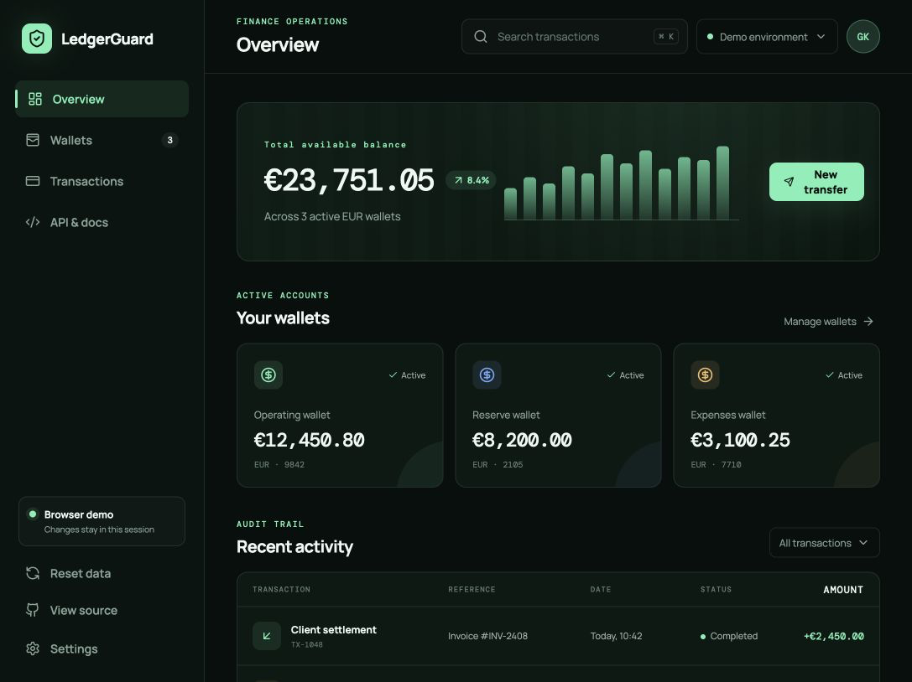
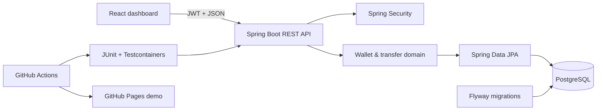

# LedgerGuard

[](https://github.com/GKARAMOU/ledgerguard/actions/workflows/ci.yml)
[](https://gkaramou.github.io/ledgerguard/)
[](https://openjdk.org/)
[](https://spring.io/projects/spring-boot)

LedgerGuard is a secure digital-wallet platform built to demonstrate the backend concerns that matter in financial systems: atomic balance updates, duplicate-request protection, concurrency control, authentication, database migrations and a complete automated delivery pipeline.

**[Open the interactive live demo](https://gkaramou.github.io/ledgerguard/)** · **[View API workflow](#api-workflow)**



> The public demo is an interactive browser simulation so it can run free on GitHub Pages. It uses the same transfer rules and interface as the project, while the Spring Boot API and PostgreSQL database run locally through Docker Compose.

## Highlights

- Java 21 and Spring Boot REST API with a layered, domain-focused structure
- JWT authentication with stateless Spring Security configuration
- Atomic wallet-to-wallet transfers using `@Transactional`
- Idempotency keys that protect clients from duplicate payments
- Optimistic locking through JPA `@Version` and conflict-safe error responses
- Validation for balances, currencies, wallet state and transfer amounts
- PostgreSQL schema versioning and demo data through Flyway
- OpenAPI documentation and Swagger UI
- JUnit integration tests, MockMvc security tests and Testcontainers PostgreSQL verification
- React, TypeScript and Vite operations dashboard with responsive design
- Multi-stage Docker images, Docker Compose and GitHub Actions CI/CD

## Architecture



## Run the complete application

Requirements: Docker Desktop with Docker Compose.

```bash
git clone https://github.com/GKARAMOU/ledgerguard.git
cd ledgerguard
cp .env.example .env
docker compose up --build
```

Then open:

- Dashboard: `http://localhost:3000`
- Swagger UI: `http://localhost:8080/swagger-ui.html`
- Health check: `http://localhost:8080/actuator/health`

The repository ships with local demo credentials (`demo` / `ledgerguard`). Change `DEMO_PASSWORD`, `JWT_SECRET` and the database password in `.env` before using any non-local environment.

## API workflow

### 1. Create a JWT

```bash
curl -s http://localhost:8080/api/auth/token \
  -H 'Content-Type: application/json' \
  -d '{"username":"demo","password":"ledgerguard"}'
```

Copy the `accessToken` value into `TOKEN`.

### 2. List wallets

```bash
curl -s http://localhost:8080/api/wallets \
  -H "Authorization: Bearer $TOKEN"
```

### 3. Transfer funds exactly once

```bash
curl -i http://localhost:8080/api/transfers \
  -X POST \
  -H "Authorization: Bearer $TOKEN" \
  -H 'Content-Type: application/json' \
  -H 'Idempotency-Key: client-request-2026-001' \
  -d '{
    "sourceWalletId":"d72d4a7b-a94c-4c21-9eb8-880cc44df101",
    "destinationWalletId":"38e8bf9c-2ca6-482f-88cd-5ccf783c6102",
    "amount":125.50,
    "reference":"Operations reserve"
  }'
```

Sending the same request with the same `Idempotency-Key` returns the original transfer and does not debit the wallet twice.

## API endpoints

| Method | Endpoint | Purpose |
| --- | --- | --- |
| `POST` | `/api/auth/token` | Authenticate and create a JWT |
| `GET` | `/api/wallets` | List current wallet balances |
| `GET` | `/api/wallets/{id}` | Read one wallet |
| `POST` | `/api/transfers` | Create an idempotent atomic transfer |
| `GET` | `/api/transfers` | List and paginate transfers |
| `GET` | `/api/transfers/{id}` | Read one transfer |
| `GET` | `/actuator/health` | Container and service health |

## Development without Docker

Start PostgreSQL first, then run the API:

```bash
cd backend
mvn spring-boot:run
```

In another terminal, run the dashboard:

```bash
npm install
npm run dev
```

## Tests and quality checks

```bash
# Frontend
npm ci
npm run lint
npm test
npm run build

# Backend
cd backend
mvn verify
```

`PostgresSchemaIntegrationTest` uses Testcontainers when Docker is available and verifies the real Flyway migrations against PostgreSQL. The remaining service and security integration tests run with an isolated in-memory database.

## Transaction guarantees

1. The API validates the idempotency key and checks whether it already has a completed transfer.
2. Both wallets are loaded and validated for status, currency and available funds.
3. Debit and credit happen inside one database transaction.
4. The wallet version is checked when JPA flushes the update; a competing update returns a conflict instead of silently overwriting a balance.
5. PostgreSQL constraints provide a final line of defense against negative balances, duplicate keys and same-wallet transfers.

## Repository layout

```text
ledgerguard/
├── backend/                    # Spring Boot API and tests
│   ├── src/main/java/          # Auth, wallet, transfer and shared layers
│   ├── src/main/resources/     # Configuration and Flyway migrations
│   └── src/test/               # JUnit, MockMvc and Testcontainers tests
├── src/                        # React + TypeScript dashboard
├── docs/                       # README screenshot
├── .github/workflows/          # CI and GitHub Pages deployment
├── docker-compose.yml
└── Dockerfile
```

## License

Released under the [MIT License](LICENSE).
